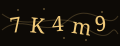

# NASLAB Member Portal — Auth Screens · Handover Spec

**For:** IT / backend team
**Scope:** Login · Register · Forgot password · Reset password
**Design source:** naslabtec.com redesign — same colours, same type, same button behaviour.

---

## 0. What this package is

Four **static, self-contained HTML pages**. No build step, no framework, no npm.
Open `index.html` in any browser and everything works offline except the two Google Fonts
(see §5 if you need them self-hosted).

**Nothing here talks to a server.** Every form calls `preventDefault()` on submit — see §3
for exactly what to remove when you wire it up.

```
portal-auth/
├─ index.html          ← start here (deliverable index)
├─ login.html
├─ register.html
├─ forgot.html
├─ reset.html
├─ SPEC.md             ← this file
└─ assets/
   ├─ auth.css         ← all styling, one file
   ├─ auth.js          ← all behaviour, one file
   ├─ video/
   │  └─ lock.mp4      ← left brand panel, desktop only
   └─ img/
      ├─ naslab-logo-mark.png
      ├─ naslab-wordmark.png
      ├─ lock-poster.jpg      ← lock.mp4 first frame (empty floor)
      ├─ lock-still.jpg       ← lock.mp4 last frame, reduced-motion fallback
      └─ captcha-sample.svg   ← placeholder only, replace with the live captcha
```

### The left brand panel

All four pages share one video (`assets/video/lock.mp4`, 1080×1440, 3s) — the NASLAB
padlock assembling itself. It **plays once on page load and stops on the final frame.
It does not loop.** Each page carries its own line of copy over it.

It is desktop-only (≥ 901px). Two fallbacks are wired already: `prefers-reduced-motion`
and blocked autoplay both swap in `lock-still.jpg`, which is that same final frame.

---

## 1. Fields — identical to what is live today

These were read off the **live** `member.naslabtec.com` forms. The `name` attributes match,
so **the backend does not need to change**.

### `/login`
| name | type | notes |
|---|---|---|
| `email` | email | live form uses `type="text"`; changed to `type="email"` for mobile keyboards — same value posted |
| `password` | password | |
| `captcha` | text | |
| `remember` | checkbox `1` | **new, optional** — drop the checkbox if you don't want it |

### `/register`
| name | type | notes |
|---|---|---|
| `email` | email | |
| `password` | password | |
| `password_confirmation` | password | |
| `sponsor_id` | text | label reads "Sponsor ID" — confirm the exact live name before wiring |
| `captcha` | text | |

### `/password/forgot`
`email`, `captcha`

### `/password/reset`
`token` (hidden, from the email link), `email`, `password`, `password_confirmation`

> ⚠️ **Confirm the live `name` for Sponsor ID.** The rendered label is "Sponsor Id"; this
> package assumes `sponsor_id`. If the live form posts something else, change that one
> attribute — nothing else depends on it.

---

## 2. Captcha

Structure matches the live one: an `` plus a refresh control.

```html

```

Replace `src` with the live captcha endpoint. `auth.js` refreshes it by appending
`?t=<timestamp>` to bust the cache — same effect as the current "Refresh" link.

The bundled `captcha-sample.svg` is a **drawing**, not a real captcha. Remove it on go-live.

---

## 3. Wiring it up — exactly three things

1. **`assets/auth.js`, in the submit handler:** delete the `e.preventDefault()` block marked
   `[接线]` and let the form post normally (or swap in `fetch()`).
2. **CSRF:** each `<form>` has a comment marking where the hidden token goes
   (`<input type="hidden" name="_token" value="{{ csrf_token() }}">` for Laravel).
3. **Server-side errors:** each field already has an error slot:
   ```html
   <p class="field__error" id="email-error" role="alert"></p>
   ```
   Render the message into it and add `class="field__error is-on"`, plus
   `aria-invalid="true"` on the input. Styling is already there.

Client-side validation in `auth.js` is **convenience only**. Re-validate everything server-side.

---

## 4. Behaviour built in

- Password show/hide on every password field.
- Password strength bar (register + reset) — a hint only, does not block submit.
  Threshold stays the live rule: **minimum 6 characters**.
- Inline validation fires on **blur**, not on every keystroke.
- Submit button locks and shows a loading label while in flight.
- Forgot password switches to a "check your inbox" panel. The copy deliberately does
  **not** reveal whether the address exists — do the same server-side.
- Language menu: 14 locales, links to `/lang/{code}` exactly like the live site.
- `ar` / `fa`: set `<html dir="rtl">` — the RTL rules are already in `auth.css` (§ RTL).

---

## 5. Fonts

Loaded from Google Fonts in each page `<head>`:

- **Cormorant Garamond** 300/400/500 + italic — headings
- **Plus Jakarta Sans** 400/500/600/700 — everything else

If your environment blocks Google Fonts, self-host both and swap the `<link>` for a local
`@font-face`. The CSS variables `--font-display` / `--font-body` are the only two places
the families are named.

---

## 6. Design tokens (do not improvise)

```
--bg           #070503   pure onyx black — the page must bottom out on this
--cream        #efe7d8   body text
--gold         #f0c979   champagne gold — the only accent
--gold-deep    #d8a94f   gradient end on the primary button
--line         rgba(240,201,121,.18)
--line-strong  rgba(240,201,121,.34)
```

**No orange-red. No blue. Anywhere.** Black and champagne gold is the whole palette.

Primary button = solid gold gradient, dark text, pill radius, with the site's signature
hover (black wipes in from the left, text flips to gold). Do not replace it with a flat fill.

---

## 7. Responsive

- **≥ 901px** — two columns: brand panel left (46%), form right (54%).
- **≤ 900px** — brand panel hides, top bar carries the logo, form goes full width.
  This is the same 901px breakpoint the main site uses.

---

## 8. Accessibility

- Every input has a real `<label for>`.
- Error slots are `role="alert"`, so screen readers announce them.
- Focus ring is a 2px gold outline, visible on every control.
- Respects `prefers-reduced-motion`.
- Decorative images have `alt=""`; the wordmark has `alt="NASLAB"`.

---

## 7. i18n(2026-07-23 新增)

- **14 语种**全部内置在 `assets/i18n.js`(en·cn·ja·ko·th·vi·id·hi·fa·ar·tr·es·it·de),
  61 键 × 14 语种,含表单校验文案。HTML 用 `data-i18n*` 属性打标,无需构建。
- **语言怎么定**:`?lang=xx` > 路径 `/lang/xx` > localStorage > en。
  线上若保留 `/lang/{code}` 整页跳转:删掉 i18n.js 末尾 **MENU 拦截**那一段即可,
  服务端不用输出任何翻译 —— 前端照常接管。
- **RTL**:ar / fa 自动 `dir="rtl"`,镜像规则在 auth.css(既有)+ RTL 下 letter-spacing 归零(连写字母)。
- **字体**:非拉丁字形走系统字体栈(auth.css 末尾 per-lang 覆盖),不新增字体文件。
- 条款/隐私链接在字典里统一指向 `naslabtec.com/contact` 占位 —— **[接线] 换真实地址**(搜 `LINK`,一处)。
